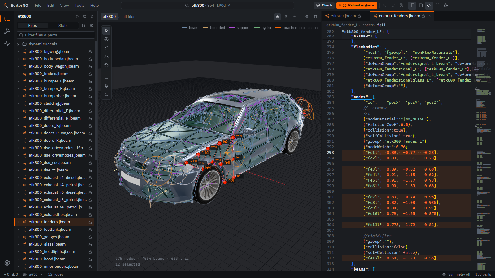
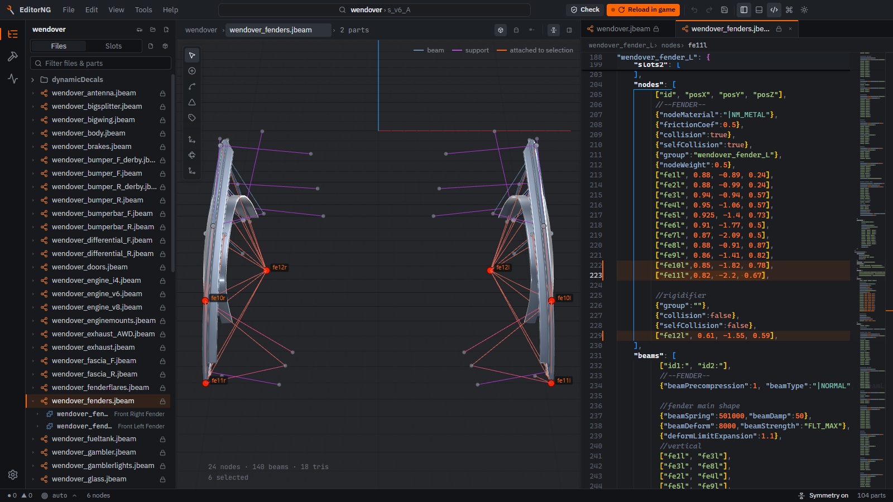
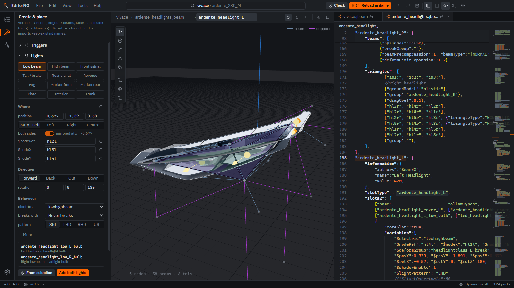
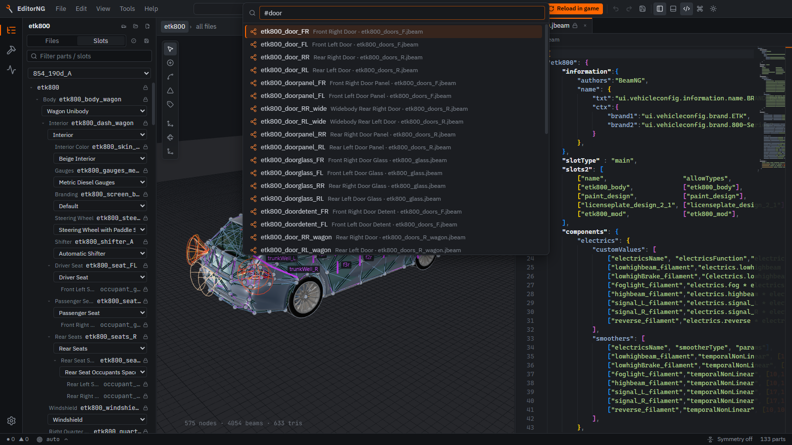
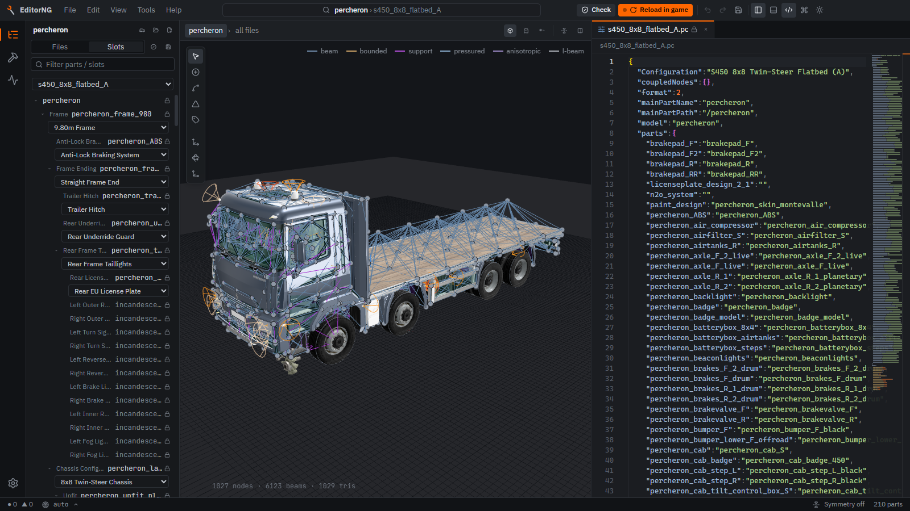
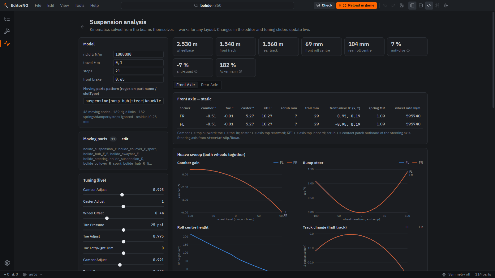

# EditorNG

A JBeam editor for BeamNG.drive: 3D node/beam/triangle editing next to a JBeam-aware code
editor, Blender import, placement tools for 0.40-era systems, structural checks and a generic
suspension kinematics analyser.



## Download

Get the latest zip from [Releases](https://github.com/EditorNG/EditorNG/releases/latest), unzip
it anywhere and run `EditorNG.exe` (Windows 10/11, no installer). It finds your BeamNG.drive
install by itself. The [user guide](docs/USER_GUIDE.md) covers everything.

## What it does

**Edit in 3D and in code at the same time.** Click a node, beam or triangle and the code
editor jumps to its row; move the cursor in the code and the 3D view highlights it. Blender-style
controls: G/R/S to move, rotate and scale, Shift+A to add, Ctrl to snap to a node.

**Work on one side, get both.** With X symmetry on, every edit is mirrored to the twin nodes,
beams and triangles on the other side, even in the other side's part. Show a single file or part
to focus on it.



**Place 0.40-era systems without typing them out.** Lights (slots2 bulbs) from a light type,
with names, direction and the mirrored side filled in; occupant seats with their rigidifier;
rails and slidenodes. And triggers: tired of nudging trigger boxes by hand since the day they
came out? Pick three nodes, pick the action from a menu of every one the game has, done.



**Find anything fast.** The search bar finds files, parts (`#`), nodes (`@`), commands (`>`) and
text in every file (`%`).



**Config view.** Load any `.pc`, swap the part in any slot and see the result straight away,
then save it as a new configuration.



**Suspension analysis.** Camber, toe, caster, roll centres, anti-dive and anti-squat, solved from
the beams themselves, so it works for any suspension layout and updates as you edit.



And more: the Shaded view with the game's materials, structural checks before release, weight
distribution, Blender import and live link, merging with edits made in other programs, one-click
reload in game.

Screenshots show vanilla BeamNG.drive vehicles (ETK 800, Wendover, Ardente, Percheron, Bolide),
© BeamNG GmbH.

## Development

Requirements: Node.js 22+ (developed on Node 26), Windows.

```sh
npm install            # in npm 11+: npm install-scripts approve electron esbuild
npm run dev            # Vite dev server + Electron with hot reload
npm run build          # out/main, out/preload, out/renderer
npm start              # run the built app
npm test               # vitest: parser, assembly, editing, suspension (uses your BeamNG install)
npm run typecheck
npm run package        # release/EditorNG-win32-x64 + zip
```

The launch scripts clear `ELECTRON_RUN_AS_NODE`, which VS Code terminals set and which would make Electron behave like plain Node.

`node scripts/shot.mjs <name> [--file script.js] [--exe path] [--post blender.json]` launches the
app with an isolated profile, runs a script against `window.__app` and saves `shots/<name>.png`.
It's used for visual checks.

## Layout

| Path | What |
|---|---|
| `src/core/sjson.ts` | Tolerant SJSON parser with source offsets (comments, missing/extra commas). |
| `src/core/jbeam/` | Port of the game's loader: slots/slots2, `.pc` configs, variables and `$=` expressions, components, table modifiers, node transforms (`assemble.ts`, `expr.ts`, `nodeTransform.ts`); surgical text edits (`edit.ts`); row generators for triggers2/bulbs/occupants/wheels (`generators.ts`); reference docs (`docs.ts`). |
| `src/core/analysis/` | Structural checks and mass report (`debug.ts`), suspension kinematics solver (`suspension.ts`). |
| `src/core/import/mesh.ts` | Blender/OBJ mesh → nodes, beams, triangles with naming, mirroring and re-import matching. |
| `src/core/dae.ts` | Fast COLLADA reader (runs in a worker). |
| `src/main/` | Electron main process: BeamNG virtual file system over game zips / mods / user folder (`vfs.ts`), file IO with backups, watching, Blender bridge and live-link HTTP server. |
| `src/renderer/` | React UI: workspace (documents = Monaco models, global undo), three.js viewport, Monaco JBeam language, panels, pages. |
| `blender/` | Headless extraction script and the live-link add-on. |

Design rules: the JBeam text is the source of truth (every tool emits minimal text edits);
assembly follows the game's rules so the view matches what spawns; anything read-only (game
zips) stays read-only until copied into a mod.

Note for Git Bash on Windows: run vitest from a path with an uppercase drive letter
(`cd /C/Users/...`); a lowercase `c:` path makes vitest fail with "Cannot read properties of
undefined (reading 'config')".

## License

MIT, see [LICENSE](LICENSE). Bundled fonts and libraries keep their own licenses, in [licenses/](licenses/).
